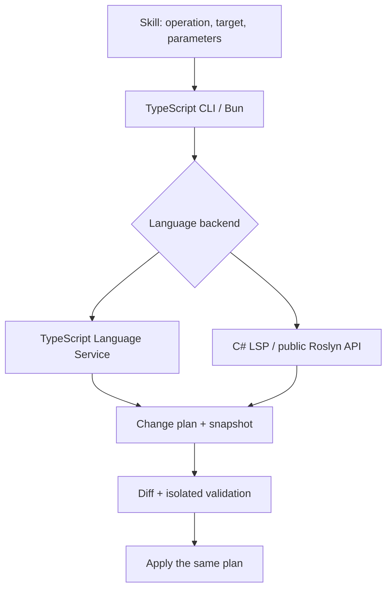

# Deterministic refactoring skills

Status: architecture design with a first working MVP. Date: 2026-10-04. Current commands and limitations: [README](../README.md).

Agreed scope: TypeScript/JavaScript and C#/.NET; scripts and CLI in TypeScript, run and built with Bun. Local work only, no GitHub operations. The command names, directories and contracts below are proposals; they do not denote features that are already available.

## Recommendation

Build one deterministic runner with thin skills for specific operations. The model selects the operation, the symbol or range, and the parameters. An existing language engine computes the changes. The runner checks them, shows a diff and applies exactly the prepared plan. A skill contains no instructions for the model to rewrite code and no fallback manual-editing mode.

ReSharper is the source of functional inspiration, and the engine for the respective language is the source of semantics. The shared contract does not require an identical operation catalog in both languages. A capability missing from a given backend must yield `UNSUPPORTED`, without generating substitute code.

This is a design decision: repeatable execution means the same result for the same project snapshot, engine version, configuration and request. It does not mean a mathematical proof that program behavior is preserved. Engines have bugs too, and reflection, external API consumers and dynamic JavaScript limit what they can know.

## Source material

- [ReSharper/Roslyn catalog](research/resharper-roslyn-catalog.md): operations, priorities and risks.
- [TypeScript/JavaScript engine](research/typescript-engine.md): available APIs, alternatives and experiments.
- [C#/.NET engine](research/csharp-engine.md): public Roslyn API, LSP and integration boundaries.

## Minimal architecture



### TypeScript and JavaScript

Preferred first backend: the public TypeScript Language Service. ts-morph is a candidate auxiliary layer for project and AST handling if it simplifies the implementation; there is no need to maintain two parallel models of the same project.

VS Code documents its use of the TypeScript Language Service and of rename, extract function/constant/type, and moving declarations to a file. This confirms that the features exist in the engine, but the adapter still has to check the available actions for a specific range and version. [Microsoft documentation](https://code.visualstudio.com/docs/typescript/typescript-refactoring).

For rename, the prefix/suffix returned by the engine must be honored: a local change from `a` to `b` may require `{ a: b }` and `export { b as a }` if the contract is to stay the same. ts-morph documents this mode and by default disables changes to comments and strings. [Renaming](https://ts-morph.com/manipulation/renaming).

Do not use regexes or matching of identical identifiers for rename. ast-grep is suitable for additional, limited structural transformations; its documentation describes pattern matching and rewrite, not full cross-module reference analysis. [Rewrite Code](https://ast-grep.github.io/guide/rewrite-code.html). Restricting it to such transformations is our design decision.

### C# and .NET

TypeScript/Bun should drive an existing .NET engine. Roslyn Workspace exposes projects, documents, ASTs, semantic models and references, and can run outside an IDE. We do not build our own parser, type checker or symbol graph. [Workspace model](https://learn.microsoft.com/en-us/dotnet/csharp/roslyn-sdk/work-with-workspace).

Strategy: test an existing C# LSP on fixtures; if it covers the required actions and returns edits without writing files, use it. For rename, the alternative is a small .NET host that calls the public Roslyn `Renamer` and returns document changes. The host would be an adapter over existing analysis, but it remains an additional .NET component. [Renamer API](https://learn.microsoft.com/en-us/dotnet/api/microsoft.codeanalysis.rename.renamer?view=roslyn-dotnet-4.13.0).

The public `CodeRefactoringProvider` is an extension point. The mere existence of this class does not guarantee a public, stable way to invoke all of Visual Studio's built-in refactorings. Extract Method/Interface must pass a separate backend availability test. [CodeRefactoringProvider API](https://learn.microsoft.com/en-us/dotnet/api/microsoft.codeanalysis.coderefactorings.coderefactoringprovider?view=roslyn-dotnet-4.13.0).

`dotnet format` handles formatting, style and analyzer fixes, with diagnostic and file filters. It is not a universal CLI for rename or extract method. It can be used for selected cleanups run in a copy of the project. [dotnet format](https://learn.microsoft.com/en-us/dotnet/core/tools/dotnet-format).

## Proposed runner contract

```text
refactor capabilities --project <config>
refactor discover --project <config> --file <path> --range <range>
refactor plan <operation> --project <config> --request <request.json> --out <plan.json>
refactor preview --plan <plan.json>
refactor validate --plan <plan.json>
refactor apply --plan <plan.json>
```

This is an interface design, not commands available in the repository. `discover` returns the actions the engine offers for the given location, not automatic proposals to reorganize the whole architecture.

### Request

- An explicit project: `tsconfig.json`/`jsconfig.json` or `.sln`/`.csproj`; a monorepo must not be silently treated as a single project.
- An operation from the registry and parameters with a validated schema, e.g. the new name.
- A target as a file and a position or range. A symbol may be looked up by name, but multiple matches yield `AMBIGUOUS_TARGET`.
- Proposed canonical representation: UTF-16 offsets in the snapshot text; the CLI may accept 1-based positions, and the LSP adapter converts them according to the negotiated position encoding.
- Separate modes for renaming a local binding and renaming an API. Do not infer consent to change a public contract from the new name alone.

### Plan

The plan should contain the schema version, operation, parameters, backend and its version, formatting configuration, snapshot identifier and the list of text/file operations. It must not contain a timestamp or random ID in the data subject to determinism comparison.

The fingerprint covers the entire declared semantic context: source files, configuration, project references, lockfile and dependency/engine versions. Hashing only the files recorded in the plan is insufficient: a change to another file can change symbol resolution. For large projects, optimize the snapshot only after the baseline solution is correct.

File operations have explicit preconditions: source content, non-existence of the new target, write permissions and path consistency after resolving symlinks. In the MVP, reject targets outside the project root, generated files and dependency directories. For linked files in C# and files shared by several tsconfigs, account for every context or return `PROJECT_SCOPE_INCOMPLETE`.

### Flow

1. Load the full declared project and wait for the engine to be ready; establish baseline diagnostics.
2. Resolve the target and check action availability, name conflicts and required parameters.
3. Obtain edits from the engine and convert them into a validated plan without writing to the user's project.
4. Compute the result in an overlay or working copy, preserving project references and paths. Show the diff; format only the ranges required by the chosen action.
5. Verify diagnostics/compilation and relevant tests in isolation; bind the validation result to the plan and snapshot hashes. Compare pre-existing errors by code and context, accounting for position shifts, instead of blocking every project that has old errors.
6. Before writing, re-check the snapshot, plan hash and validation result. Do not recompute a different version of the refactoring during `apply`.
7. Write the prepared changes with a journal and the ability to restore. On partial failure, restore only the files written by this transaction, provided they have not since been changed by another process.

Writing multiple files on an ordinary filesystem is not a single atomic operation. The proposed runner requires preparing all results, atomically replacing individual files, and a recovery journal for interruptions. It must not promise global atomicity or overwrite concurrent user edits during rollback.

### LSP support

LSP standardizes rename, code actions and workspace edits; edits may include creating, renaming and deleting files, with ordering that must be preserved. Availability of a specific refactoring depends on the server. [LSP specification](https://microsoft.github.io/language-server-protocol/specifications/lsp/3.17/specification/).

Adapter proposal:

- Negotiate capabilities; correctly handle `initialize`, document open/versions, action resolve and project readiness.
- Preserve the order of `documentChanges`. For independent edits of one snapshot, check for overlap and apply from the largest offset. Do not globally sort an LSP sequence that contains file operations.
- Identify actions via the given backend's mechanism, kind, data and context. LSP does not guarantee a universal stable ID for every refactoring; UI labels and result order are not a contract.
- The MVP allows actions that produce pure edits. Actions requiring `executeCommand` only in the adapter of a vetted server, with `workspace/applyEdit` intercepted into the plan and no effects outside the overlay. The rest return `UNSUPPORTED_ACTION_PROTOCOL`.
- Do not execute commands received from the server as arbitrary shell code.

### Results and errors

Machine output in JSON plus a readable diff. The states `available`, `unsupported`, `blocked`, `planned`, `validated`, `applied`, `failed` are sufficient; a missing backend is not a success. Errors must distinguish, among others, `UNSUPPORTED`, `AMBIGUOUS_TARGET`, `PROJECT_SCOPE_INCOMPLETE`, `NAME_CONFLICT`, `STALE_SNAPSHOT`, `OVERLAPPING_EDITS`, `VALIDATION_FAILED` and `UNSUPPORTED_ACTION_PROTOCOL`.

## Skills as the operational interface

Each future `SKILL.md` should contain the scope of use, required inputs, invocations of the existing runner, interpretation of results and refusal conditions. It should not contain an algorithm for manually rewriting code. Do not publish a skill that refers to a nonexistent script.

Proposed layout once implementation starts:

```text
src/cli.ts
src/core/                 # request, plan, snapshot, diff, validate, apply
src/backends/typescript/  # public Language Service adapter
src/backends/csharp/      # vetted LSP / Roslyn host adapter
skills/refactor-rename/SKILL.md
skills/refactor-extract-function/SKILL.md
skills/refactor-extract-variable/SKILL.md
skills/refactor-move-file/SKILL.md
skills/refactor-imports/SKILL.md
tests/fixtures/typescript/
tests/fixtures/csharp/
```

A single CLI provides shared write and validation rules. The first version needs no separate plugin framework, daemon, database or MCP server. If a Roslyn host later proves necessary, split it out into its own small .NET project without moving orchestration out of TypeScript.

Distribution: first `bun run` scripts, then a CLI build via `bun build --compile`. Bun documents standalone executables, but the .NET server/helper remains a separate requirement. [Bun executables](https://bun.sh/docs/bundler/executables). Compiling the CLI does not replace type-checking the runner or the project being refactored.

## Tests required for the implementation

These are acceptance criteria for the future tool; at the analysis stage they do not denote passing tests of a production runner.

| Area | Regression examples |
| --- | --- |
| Rename TS/JS | import alias, re-export, shadowing, shorthand property, TSX, comments/strings unchanged, conflict, preserving the public export name in local mode |
| Rename C# | overloads, partial class, interface/override, two solution projects, `nameof`, conflict, reflection as a limitation |
| Extract | valid and rejected ranges, inputs/outputs, `return`/`break`/`await`, `this`, closure, side effects; naming the result via engine rename |
| Files | imports/using/namespace according to the appropriate operation, project references, target collision, create+edit in LSP, rename differing only in letter case |
| Imports | module with side effects, unused value import, type-only import, initialization order; explicit policy for remove |
| Transaction | file or configuration change after planning, overlapping edits, interrupted write, rollback with an external edit, CRLF/BOM and non-BMP characters |
| Repeatability | two plans for an identical snapshot are identical; a second cleanup makes no changes; re-applying an old plan detects the state and does not apply it a second time |
| Result quality | baseline and post-change diagnostics, compilation and a behavior test for the specific fixture; a snapshot diff alone is not enough |

Fixtures cover both valid transformations and refusals. Idempotence applies to operations such as cleanup, not to arbitrary extract. CLI build tests must also verify that the TypeScript standard libraries are found and that the .NET backend starts after bundling.

## Implementation order

1. Verify the minimal capabilities of both backends on small projects: rename, extract actions and cleanup. The result records actual support, not a list of IDE features.
2. Runner and rename: the full path from request through plan/preview/validate to apply, in TS and C#. Only then the first working skill.
3. Sorting imports/usings and selected fixes from an explicit allowlist; TS import removal separated from sorting.
4. Extract function/variable where a vetted backend provides the transformation; lack of support in C# does not block a finished TS implementation.
5. Move/rename file with reference updates; move declaration/type separately, because it is a different operation from moving a file.
6. Further refactorings only after fixtures and API confirmation: extract interface/type, introduce parameter object, encapsulate field, inline, change signature.

The first release should be small and complete rather than contain a broad catalog of stubs.

## Delivered first release

`src/cli.ts` implements `capabilities`, `plan`, `preview`, `validate` and `apply`. The MVP interface takes parameters directly via flags; `discover` and the `--request` input from the earlier proposal have not been implemented.

| Backend | Working operations | Engine used |
| --- | --- | --- |
| TS/JS | rename, sort imports, remove unused imports, format, extract function, extract variable | TypeScript 5.9.3 Language Service |
| C#/.NET | rename, remove unused using, format | Public Roslyn 4.12.0, MSBuildWorkspace, Renamer, CS8019, Formatter |

C# uses a small .NET helper driven by TypeScript/Bun. The attempted cleanup via `dotnet format` was replaced by removing the nodes flagged by the existing Roslyn compiler diagnostic `CS8019`, preserving trivia. No custom unused-using analyzer or private Extract Method provider was written.

TS rename additionally compares semantic locations before/after, accounting for offset changes and prefix/suffix. This is meant to reject capture/shadowing that may not cause new compilation errors. Extract uses pinned IDs of existing actions followed by a semantic rename.

The runner records a plan of whole resulting files with the original text, snapshot hash and in-memory diagnostics. `validate` checks freshness and the result of that analysis; it does not yet run an arbitrary application build/tests in an isolated copy. The snapshot covers the root excluding tool/dependency directories; it is not a complete fingerprint of libraries outside the root. These parts of the original design remain to be developed.

Writing uses atomic replacement of individual files, a lock and a journal of the original content; a forced write-failure test confirms rollback of an earlier file. Automatic recovery after the process is killed is deferred. We do not claim an atomic multi-file transaction.

The five skills in `skills/` refer to the existing CLI. `bun run demo --built` shows plan/diff/apply on copies of TS, JS and C# examples, checks the run output before/after, and checks that a subsequent format is a no-op. The example templates remain unchanged by the demonstration.

## Language-specific npm distribution

The source engines remain shared, while npm packages select their backend at build time. `src/cli-core.ts` owns planning and saved-plan commands through an injected `BackendLoader`; it imports no concrete engine. `src/cli.ts` and the aggregate npm CLI use `src/backends/load.ts` to select either engine. Language-specific entries inject only the TypeScript or C# adapter, allowing Bun to exclude the other adapter from the bundle.

`src/npm-config.ts` defines fourteen distributions: the aggregate CLI, seven TS/JS operations and six C# operations. TS packages contain no Roslyn helper. C# packages contain no TypeScript npm dependency. A language package rejects foreign project files and saved plans before loading a compiler or applying edits. The generated package help and examples follow the selected language. See [npm CLI packages](npm-packages.md) for package names, executables and requirements.
